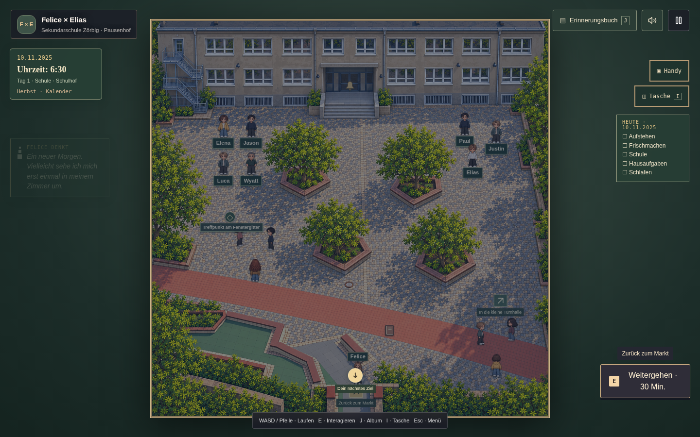
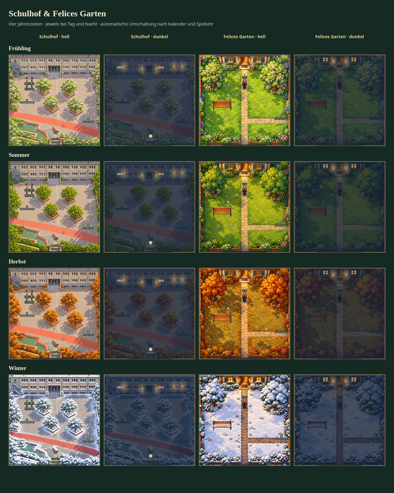

# pixelspiel · Felice × Elias World

Ein 2D-Pixelspiel über Felice und Elias mit zwei Spielmodi:

- **Die verlorenen Erinnerungen** (Startmenü: *Neues Spiel*): Elias ist verschwunden, ein Schatten hält ihn zwischen euren Erinnerungen gefangen. Sechs Haupträtsel, vier Erinnerungsfragmente, Inventar, Ermittlungsakte und Hinweise. Etwa 30 Minuten. Details: [game/adventure/README.md](game/adventure/README.md).
- **Unser Jahr** (Startmenü: *Unser Jahr (Chronik)*): eine begehbare Welt vom **10.11.2025** bis zum **02.11.2026** in acht Kapiteln, mit Schule, gemeinsamen Wegen, Chatabenden und Erinnerungsalbum.

**Aktuelle Spielversion: 1.5** · Desktop und Smartphone · Spielstände im Browser



## Was dich erwartet

- **Ein Rätsel-Abenteuer** mit Escape-Room-Rätseln, Detektivakte, drei Hinweisstufen pro Rätsel und einem Brief am Ende.
- **Eine zusammenhängende Geschichte** mit Dialogen, Antwortmöglichkeiten und wiederholbaren Erinnerungen.
- **Eine begehbare Spielwelt** mit Felices Wohnung, Radegast, Zörbig, Schule, Schießstand, Spielplatz, Weihnachtsmarkt und Elias’ Zimmer.
- **Handy und Erinnerungsalbum** mit Nachrichten, Kalender, Fortschritt und gesammelten Erinnerungsstücken.
- **Alltag und Jahreszeiten:** zur Schule fahren, Unterricht besuchen, sitzen, ausruhen und schlafen.
- **Gemeinsame Momente und Minispiele:** Schießen in Gölzau, Familienbesuche und die Abschlussfeier mit Fotos.

Ergänzte Dialoge und inszenierte Szenen sind im Spiel als Rekonstruktionen gekennzeichnet.

## Schulhof und Felices Garten zu jeder Jahreszeit

Beide Orte haben jeweils vier Jahreszeitenbilder und eine helle Tages- sowie dunkle Nachtansicht: **16 Kombinationen** insgesamt. Der Spielkalender wählt automatisch die Jahreszeit; die Spieluhr steuert Licht und Dämmerung.

| Jahreszeit | Schulhof und Garten |
| --- | --- |
| **Frühling** | Frisches Grün, rosa und weiße Blüten |
| **Sommer** | Dichte grüne Baumkronen und warmes Tageslicht |
| **Herbst** | Goldene und orange Blätter, herbstliche Bodenfarben |
| **Winter** | Schnee auf Bäumen, Dächern und Beeträndern, freie Wege |

Nachts leuchten die vorhandenen Außenlampen und ausgewählte Fenster. Der Übergang bei Sonnenauf- und -untergang ist weich; im Winter wird es früher und deutlich dunkler als im Sommer, wo die Nächte heller bleiben. Laufwege, Eingänge und Ruheplätze behalten ihre Positionen.



## Schüler auf dem Pausenhof (Chronik)

| Spielzeit | Was auf dem Hof passiert |
| --- | --- |
| **06:00–07:15 Uhr** | 27 Schülerfiguren stehen in Gruppen auf dem Hof und bewegen sich nicht: Elena, Jason, Luca und Wyatt im Kreis; eine unbekannte Dreiergruppe; 20 weitere Schüler in sieben Gruppen. Alle Gruppen stehen im Kreis und schauen einander an. Drei Schüler kommen etwas später vom Bus am Markt dazu und schließen sich ihrer Gruppe an. |
| **Ab 07:15 Uhr** | Die zusätzlichen Morgengruppen gehen in den Unterricht. Die vier bisherigen Schulfreunde behalten ihre Pausenfunktionen. |
| **Ab 13:00 Uhr** | Zwanzig Schüler kommen gruppenweise aus dem Eingang. Zehn bleiben in drei Gruppen auf dem Hof, zehn laufen in vier Gruppen zum Bus am Zörbiger Markt und stellen sich dort wieder im Kreis auf. |
| **Bis 14:00 Uhr** | Die Busgruppen warten an der Haltestelle. |
| **Bis 18:00 Uhr** | Die Hofgruppen bleiben draußen. |

Die Hintergrundschüler haben unterschiedliche Grafikvarianten, Größen und Blickrichtungen. Elias, Paul und Justin erscheinen auf dem morgendlichen Schulhof ebenfalls ohne Namen oder Gesprächsaufforderungen, weil Felice sie dort noch nicht kennt. Die vier bisherigen Schulfreunde bleiben ansprechbar. Die neuen Gruppen gehen um 07:15 Uhr in den Unterricht; nach Schulschluss gehen die Gruppen auf den Hof oder zum Bus. Eine Pause hält diese Bewegung an.

## Sofort lokal spielen

Du benötigst [Node.js](https://nodejs.org/), empfohlen ist **Node 24**. Die fertige Spielversion liegt bereits im Ordner `spiel/`, du musst dafür keine Pakete installieren.

1. Lade das Repository über **Code → Download ZIP** herunter und entpacke es, oder klone es:

   ```sh
   git clone https://github.com/kr511/pixelspiel.git
   cd pixelspiel
   ```

2. Unter **Windows**: Doppelklicke auf [`STARTEN.bat`](STARTEN.bat).

   Unter **macOS oder Linux**: Starte im Projektordner:

   ```sh
   node scripts/serve-local.mjs
   ```

3. Öffne **http://127.0.0.1:8765/** und wähle im Startmenü einen Spielmodus.

Lass das Terminal beim Spielen offen. Mit **Strg+C** beendest du den Server. Das Spiel läuft danach ohne Internet. Öffne es über den lokalen Server, damit Skripte und Grafiken richtig geladen werden.

`spiel/` enthält nur das gebaute Programm (`index.html` und `assets/`). Bilder, Töne und Icons liefert der lokale Server direkt aus `public/`, damit sie nur einmal im Repository liegen.

## Steuerung

| Eingabe | Aktion |
| --- | --- |
| **WASD / Pfeiltasten** | Laufen |
| **E** | Untersuchen, sprechen, benutzen oder den Ort wechseln |
| **J** | Tagebuch (Abenteuer) bzw. Erinnerungsalbum (Chronik) |
| **I** | Tasche |
| **K** | Ermittlungsakte (Abenteuer) |
| **H** | Hinweis (Abenteuer) |
| **Esc** | Pause / Menü |
| **Enter / Leertaste / Klick** | Dialogtext anzeigen und weiterschalten |

Auf dem Smartphone verwendest du den Touch-Joystick und die Aktionsknöpfe. Halte das Gerät **quer**. Das Spiel lässt sich als App auf den Startbildschirm legen (PWA).

## Spielstände

Das Spiel speichert automatisch im lokalen Browserspeicher: das Abenteuer unter `felice-elias.adventure.v1` (plus Checkpoint), die Chronik unter eigenen Schlüsseln für Kalender, Namen und Bestwerte. Spielstände gehören zum jeweiligen Browser und zur Spieladresse. Die lokale Version und die Online-Version teilen ihren Spielstand daher nicht. Wer die Browserdaten löscht, verliert den Spielstand.

## Am Quellcode arbeiten

Mit **Node 24** im Projektordner:

```sh
npm ci
npm run dev
```

Die Entwicklungsvorschau startet unter **http://127.0.0.1:5173/**.

| Befehl | Zweck |
| --- | --- |
| `npm test` | Automatisierte Tests für Spiellogik, Rätselroute, Bewegung, Speicherstände und Schülerabläufe |
| `npm run typecheck` | TypeScript prüfen |
| `npm run lint` | ESLint |
| `npm run build` | Statische Version für GitHub Pages nach `dist-pages/` bauen |
| `npm run build:spiel` | Offline-Version nach `spiel/` bauen. **Nach jeder Änderung am Spiel ausführen und `spiel/` mit committen**, sonst schlägt die CI fehl. |
| `npm start` | `spiel/` lokal starten (wie `STARTEN.bat`) |

Die Version steht nur in `package.json` (`"version": "1.5.0"`, im Spiel als „1.5“ angezeigt).

### Spieltest im echten Browser

[`scripts/check-game-browser.py`](scripts/check-game-browser.py) spielt den Prolog des Abenteuers durch (Brief, Spiegel, Ortswechsel, Schattensiegel, Belohnung, Autosave) und prüft in der Chronik gehaltene Lauftasten, Pause, Schülerabläufe sowie Layout und Joystick in zwei Handygrößen. Die CI führt ihn bei jedem Push auf `main` gegen `spiel/` aus. Lokal mit Python-Playwright, während `npm run dev` oder `npm start` läuft:

```sh
pip install playwright && python -m playwright install chromium
python scripts/check-game-browser.py --base-url http://127.0.0.1:5173/
```

Screenshots und Ergebnisse landen unter `/tmp/pixelspiel-browser-qa/`; eigene Spielstände bleiben unangetastet.

### Projektaufbau

| Ordner / Datei | Inhalt |
| --- | --- |
| `game/` | Spiellogik, Figuren, Dialoge, Kalender und Benutzeroberfläche |
| `game/Game.tsx` | Gemeinsame Welt beider Modi und die Chronik |
| `game/adventure/` | Das Rätsel-Abenteuer (Inhalte, Regeln, Speicher, Oberfläche, `useAdventure.ts`) |
| `game/texte/` | Texte der Chronik-Kapitel |
| `public/` | Raumgrafiken, Figurenatlanten, Töne, Icons, Service Worker |
| `spiel/` | Gebaute Offline-Version (nur Programmcode) |
| `index.html`, `static/` | Einstieg der Vite-App |
| `tests/` | Automatisierte Spieltests |
| `scripts/` | Lokaler Server, Browser-Test, Hilfsskripte (Icons, Chat-Import, Blender-Effekte) |

## Auf GitHub Pages veröffentlichen

Der Workflow [Deploy GitHub Pages](https://github.com/kr511/pixelspiel/actions/workflows/github-pages.yml) prüft (Tests, TypeScript, Lint, `spiel/` aktuell, Browser-Test) und baut das Spiel bei jedem Push auf `main`. Die Veröffentlichung setzt voraus, dass GitHub Pages für das Repository eingerichtet ist:

1. Öffne [Settings → Pages](https://github.com/kr511/pixelspiel/settings/pages).
2. Wähle unter **Build and deployment → Source** den Eintrag **GitHub Actions**.
3. Starte den Workflow über **Run workflow** erneut.

Nach erfolgreicher Veröffentlichung ist die Spieladresse **https://kr511.github.io/pixelspiel/**. Ohne aktivierte Pages-Veröffentlichung erzeugt der Workflow weiterhin ein herunterladbares `github-pages`-Artefakt.

## Weitere Dokumentation

- [Rätsel-Abenteuer: Ablauf, Rätsel, Speichern](game/adventure/README.md)
- [Versionsgeschichte und Details der Chronik](README-QUELLCODE.md)
- [Lokale Startanleitung](LOKAL-STARTEN.txt)
- [Story-Datenmodell](game/STORY-V09.md)
- [Schieß-Minispiel und Erinnerungen](game/memories/README.md)
