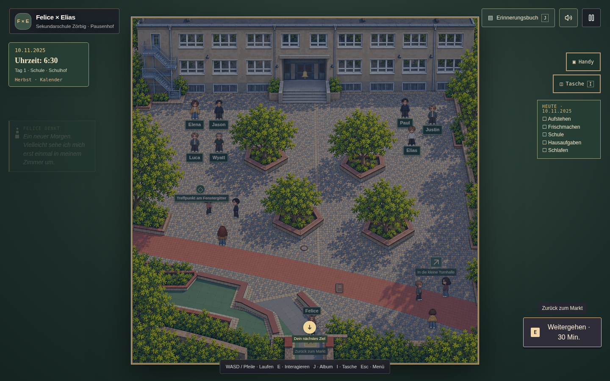
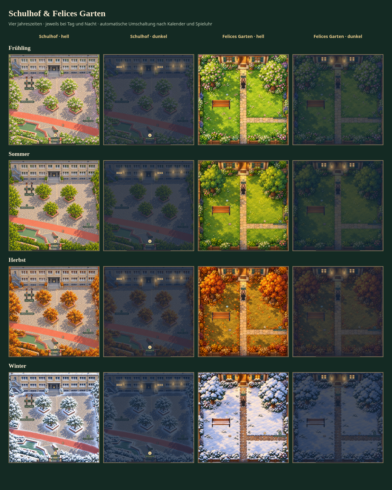

# pixelspiel · Felice × Elias World

Ein 2D-Pixelspiel über Felice und Elias: Schule, gemeinsame Wege, lange Chatabende und Erinnerungen in einer begehbaren Welt. Das Spiel beginnt am **10.11.2025** und führt in acht Kapiteln bis zum **02.11.2026**.

**Aktuelle Spielversion: 0.91** · Desktop und Smartphone · Spielstände im Browser



## Was dich erwartet

- **Eine zusammenhängende Geschichte** mit Dialogen, Antwortmöglichkeiten und wiederholbaren Erinnerungen.
- **Eine begehbare Spielwelt** mit Felices Wohnung, Radegast, Zörbig, Schule, Schießstand, Spielplatz, Weihnachtsmarkt und Elias’ Zimmer.
- **Handy und Erinnerungsalbum** mit Nachrichten, Kalender, Fortschritt und gesammelten Erinnerungsstücken.
- **Alltag und Jahreszeiten:** zur Schule fahren, Unterricht besuchen, sitzen, ausruhen und schlafen.
- **Gemeinsame Momente und Minispiele:** Schießen in Gölzau, Familienbesuche und die Abschlussfeier mit Fotos.

Ergänzte Dialoge und inszenierte Szenen sind im Spiel als Rekonstruktionen gekennzeichnet.

## Schulhof und Felices Garten zu jeder Jahreszeit

Beide Orte haben jeweils vier Jahreszeitenbilder und eine helle Tages- sowie dunkle Nachtansicht: **16 Kombinationen** insgesamt. Der Spielkalender wählt automatisch die Jahreszeit; die Spieluhr steuert Licht und Dämmerung.

| Jahreszeit | Schulhof und Garten |
| --- | --- |
| **Frühling** | Frisches Grün, rosa und weiße Blüten |
| **Sommer** | Dichte grüne Baumkronen und warmes Tageslicht |
| **Herbst** | Goldene und orange Blätter, herbstliche Bodenfarben |
| **Winter** | Schnee auf Bäumen, Dächern und Beeträndern, freie Wege |

Nachts leuchten die vorhandenen Außenlampen und ausgewählte Fenster. Der Übergang bei Sonnenauf- und -untergang ist weich; im Winter wird es früher und deutlich dunkler als im Sommer, wo die Nächte heller bleiben. Laufwege, Eingänge und Ruheplätze behalten ihre Positionen.



## Neu in Version 0.91: Schüler auf dem Pausenhof

| Spielzeit | Was auf dem Hof passiert |
| --- | --- |
| **06:00–07:15 Uhr** | 27 Schülerfiguren stehen in Gruppen auf dem Hof und bewegen sich nicht: Elena, Jason, Luca und Wyatt im Kreis; eine unbekannte Dreiergruppe; 20 weitere Schüler in sieben Gruppen. Alle Gruppen stehen im Kreis und schauen einander an. Drei Schüler kommen etwas später vom Bus am Markt dazu und schließen sich ihrer Gruppe an. |
| **Ab 07:15 Uhr** | Die zusätzlichen Morgengruppen gehen in den Unterricht. Die vier bisherigen Schulfreunde behalten ihre Pausenfunktionen. |
| **Ab 13:00 Uhr** | Zwanzig Schüler kommen gruppenweise aus dem Eingang. Zehn bleiben in drei Gruppen auf dem Hof, zehn laufen in vier Gruppen zum Bus am Zörbiger Markt und stellen sich dort wieder im Kreis auf. |
| **Bis 14:00 Uhr** | Die Busgruppen warten an der Haltestelle. |
| **Bis 18:00 Uhr** | Die Hofgruppen bleiben draußen. |

Die Hintergrundschüler haben unterschiedliche Grafikvarianten, Größen und Blickrichtungen. Elias, Paul und Justin erscheinen auf dem morgendlichen Schulhof ebenfalls ohne Namen oder Gesprächsaufforderungen, weil Felice sie dort noch nicht kennt. Die vier bisherigen Schulfreunde bleiben ansprechbar. Die neuen Gruppen gehen um 07:15 Uhr in den Unterricht; nach Schulschluss gehen die Gruppen auf den Hof oder zum Bus. Eine Pause hält diese Bewegung an.

## Sofort lokal spielen

Du benötigst [Node.js](https://nodejs.org/) — empfohlen wird **Node 24**. Die fertige Spielversion liegt bereits im Ordner `spiel/`; dafür musst du keine Pakete installieren.

1. Lade das Repository über **Code → Download ZIP** herunter und entpacke es, oder klone es:

   ```sh
   git clone https://github.com/kr511/pixelspiel.git
   cd pixelspiel
   ```

2. Unter **Windows**: Doppelklicke auf [`STARTEN.bat`](STARTEN.bat).

   Unter **macOS oder Linux**: Starte im Projektordner:

   ```sh
   node scripts/serve-local.mjs
   ```

3. Öffne **http://127.0.0.1:8765/** und klicke auf **Welt betreten**.

Lass das Terminal beim Spielen offen. Mit **Strg+C** beendest du den Server. Nach dem Herunterladen lässt sich die fertige Version offline spielen. Öffne sie über den lokalen Server, damit Skripte und Grafiken richtig geladen werden.

## Steuerung

| Eingabe | Aktion |
| --- | --- |
| **WASD / Pfeiltasten** | Laufen |
| **E** | Sprechen, benutzen oder den Ort wechseln |
| **J** | Erinnerungsalbum öffnen |
| **I** | Tasche öffnen |
| **Esc** | Pause / Menü |
| **Enter / Leertaste / Klick** | Dialogtext anzeigen und weiterschalten |

Auf dem Smartphone verwendest du den Touch-Joystick und die Aktionsknöpfe. Halte das Gerät **quer**. Das Handy lässt sich über seinen Knopf öffnen; am Schreibtisch und auf der Bettkante kannst du Chatabende erleben.

## Spielstände

Das Spiel speichert Fortschritt, Kalender, Namen und Bestwerte automatisch im lokalen Browserspeicher. Spielstände gehören zum jeweiligen Browser und zur Spieladresse. Die lokale Version und eine Online-Version teilen ihren Spielstand daher nicht automatisch.

## Am Quellcode arbeiten

Mit **Node 24** im Projektordner:

```sh
npm ci
npm run dev
```

Die Entwicklungsvorschau startet unter **http://localhost:5173/**.

| Befehl | Zweck |
| --- | --- |
| `npm test` | Automatisierte Tests für Spiellogik, Bewegung, Speicherstände und Schülerabläufe |
| `npx tsc --noEmit` | TypeScript prüfen |
| `npm run build:pages` | Statische Version nach `dist-pages/` bauen |
| `npm run build` | Serverfassung bauen |

Für einen zusätzlichen Spieltest im echten Browser gibt es [`scripts/check-game-browser.py`](scripts/check-game-browser.py). Er prüft gehaltene Lauftasten, Pause, Schülerabläufe sowie Layout und Joystick in zwei Handygrößen. Mit installiertem Python-Playwright und Chromium, während `npm run dev` läuft:

```sh
python scripts/check-game-browser.py --base-url http://127.0.0.1:5173/ --executable /usr/bin/chromium
```

Bei der statischen Entwicklungsvorschau verwende deren angezeigte Adresse einschließlich URL-Pfad. Screenshots und Testergebnisse werden unter `/tmp/pixelspiel-browser-qa/` gespeichert; eigene Spielstände bleiben unangetastet.

### Projektaufbau

| Ordner / Datei | Inhalt |
| --- | --- |
| `game/` | Spiellogik, Figuren, Dialoge, Kalender und Benutzeroberfläche |
| `game/school.ts` | Schüler und Gruppen vor Unterrichtsbeginn |
| `game/school-dismissal.ts` | Schulschluss, Laufwege zum Hof und zum Bus |
| `public/` | Raumgrafiken, Figurenatlanten und Tondateien |
| `spiel/` | Fertige Version für den lokalen Start |
| `static/` und `index.html` | Einstieg für den statischen Build |
| `app/` | Einstieg der Serverfassung |
| `tests/` | Automatisierte Spieltests |

## Auf GitHub Pages veröffentlichen

Der Workflow [Deploy GitHub Pages](https://github.com/kr511/pixelspiel/actions/workflows/github-pages.yml) prüft und baut das Spiel bei jedem Push auf `main`. Die Veröffentlichung setzt voraus, dass GitHub Pages für das Repository eingerichtet ist:

1. Öffne [Settings → Pages](https://github.com/kr511/pixelspiel/settings/pages).
2. Wähle unter **Build and deployment → Source** den Eintrag **GitHub Actions**.
3. Starte den Workflow über **Run workflow** erneut.

Nach erfolgreicher Veröffentlichung ist die erwartete Spieladresse **https://kr511.github.io/pixelspiel/**. Ohne aktivierte Pages-Veröffentlichung erzeugt der Workflow weiterhin ein herunterladbares `github-pages`-Artefakt. Der Workflow verwendet den zum Repository passenden URL-Pfad.

## Weitere Dokumentation

- [Ausführliche Spiel- und Quellcodedokumentation](README-QUELLCODE.md)
- [Lokale Startanleitung](LOKAL-STARTEN.txt)
- [Story-Datenmodell](game/STORY-V09.md)
- [Schieß-Minispiel und Erinnerungen](game/memories/README.md)
