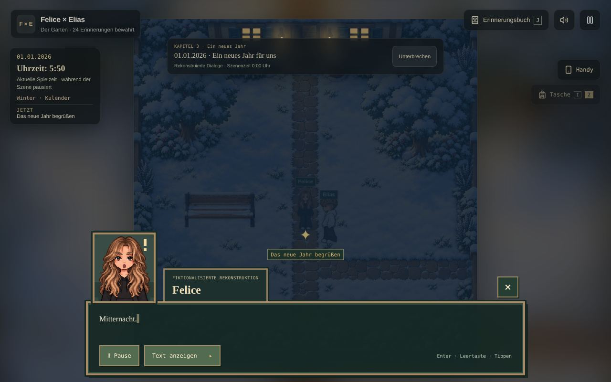
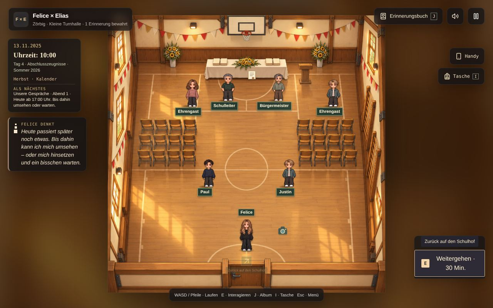
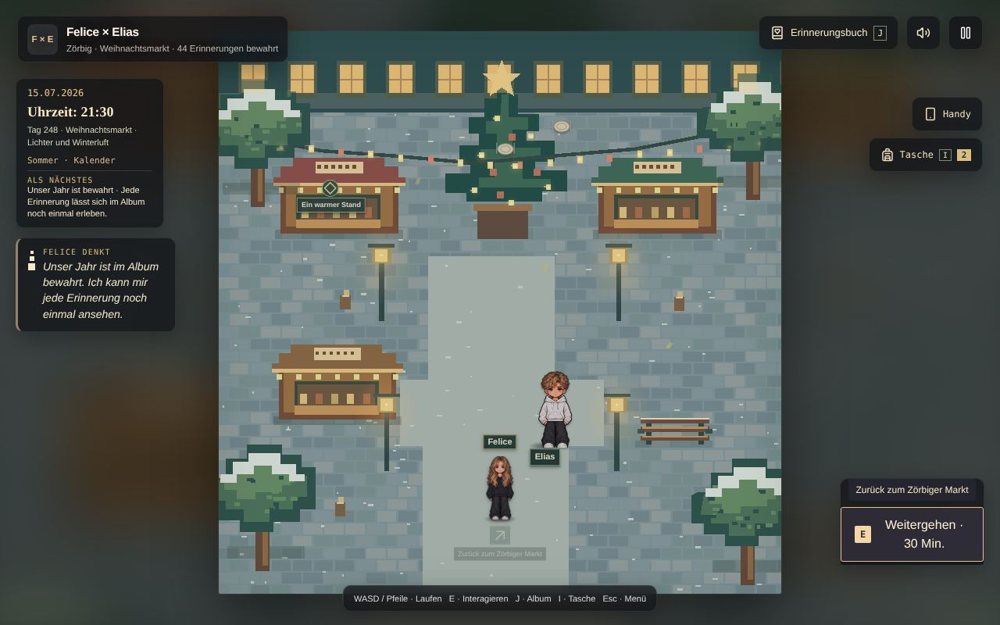
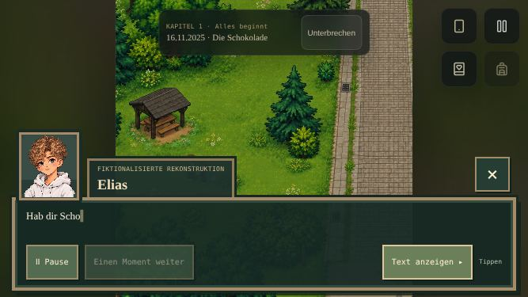
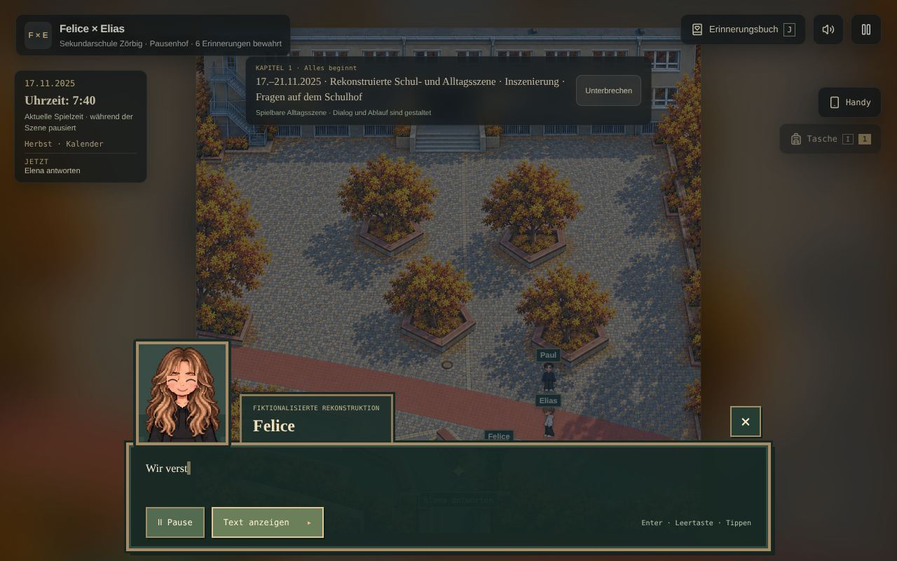

# Testbericht für Version 1.2

Stand: 18.10.2026, Basis `main` nach PR 26 (Handy-Querformat). Nur Befunde, noch nichts davon ist behoben.

## So wurde getestet

- **Komplett durchgespielt**, vom Startbildschirm über das Intro bis zum Abspann: alle 44 Erinnerungen, alle 12 Chatabende mit allen Gesprächsthemen, die Klassenfahrt und das Finale. Gespielt hat ein Bot über die echte Oberfläche, mit Laufen per Pfeiltasten, Klicks auf die Aktionsknöpfe und das Handy. Jede Zeile Text wurde mitgeschrieben, dazu kamen rund 400 Screenshots.
- **Alltag** 10.–12.11. normal gespielt: Bad, Bus, Schule, Hausaufgaben, Schlafen.
- **Alle 19 Orte frei erkundet**, an drei Zeitpunkten: November 2025 vormittags, Juli 2026 abends und nach dem Finale. Dabei jede Person angesprochen und jeden Gegenstand angeschaut.
- **Handy im Querformat** (568×320 bis 844×390): Szenen, alle Menüs, alle Handy-Reiter, Pause, Tasche, Spielstand.
- **Schieß-Minispiel** einmal gespielt, **Speichern/Laden per Datei** inklusive kaputter Datei.
- Alle Texte aus `timeline.ts`, `story.ts`, `conversations.ts` und den Menüs gelesen.

**Ergebnis in einem Satz:** Technisch stabil (kein einziger JavaScript-Fehler im ganzen Durchlauf, nichts hängt, Speichern funktioniert), aber Zeitlogik, Inszenierung auf dem Handy und vor allem die Texte haben viele kleine und ein paar große Macken.

Legende: 🔴 falsch oder störend, unbedingt fixen · 🟠 deutlich spürbar · 🟡 Kleinigkeit

---

## 1. Inhaltliche Fehler in den Texten 🔴

Das sind Sätze, die schlicht falsch sind. Jeder ist ein Einzeiler.

| Wo | Was | Fix |
| --- | --- | --- |
| Finale, `timeline.ts:398` | Elias sagt „Drei Reihen Punkte und **dein** ‚Ich liebe dich auch‘“. Felice hat die Punkte geschickt, **Elias** hat „Ich liebe dich auch“ geschrieben. | „Deine drei Reihen Punkte und mein ‚Ich liebe dich auch‘.“ |
| Wochenende bei Elias, `timeline.ts:293` | Elias: „**Deine** Eltern lieben dich jetzt schon.“ Gemeint sind seine Eltern, die Antwort lautet ja „Die sind aber auch echt lieb“. | „Meine Eltern …“ |
| Valentinstag, `timeline.ts:279` | Felice fragt „Wohin gehen wir?“ und beantwortet die eigene Frage dann per Auswahl („Einfach geradeaus“). | Frage an Elias geben. |
| Spielplatz, `timeline.ts:238` | Schritt heißt „Elias am Spielplatz treffen“, Elias sagt „Komm, wir laufen zum Spielplatz.“ Sie sind schon da. | z. B. „Naaa. Da bist du ja.“ |
| Morgen danach, `timeline.ts:264` | Felice sagt „Dein Brief …“ (zu Elias) und direkt danach „die Kraniche in **seiner** Jacke“ (über Elias). | „in deiner Jacke“ |
| Finale, `timeline.ts:399` | „Die **Wochenenden** bei dir.“ Im Spiel gibt es nur eins. | „Das Wochenende bei dir.“ |
| Valentinstag, `timeline.ts:278` | „Happy Valentinstag, **kleine**.“ ist ein rekonstruierter Satz, kein Original. | „Kleine“ |
| Jason, `story.ts` + `conversations.ts` | „Ich mache Fachabi. Neuer Abschnitt …“ schon im November 2025. Im April 2026 fährt er noch mit der 10. Klasse nach Kehl. | Satz erst ab Herbst 2026, vorher etwas anderes. |
| Schokolade, `Game.tsx:417` | Die Einleitung „Sonntag, kurz vor elf. Felice wartet an der Bank …“ (`dialogue[0]`) wird nie angezeigt, der Dialog startet bei Zeile 2. | Beim Ankommen als Erzählzeile zeigen. |

## 2. Zeit und Logik 🔴🟠

- 🔴 **Neujahr um 5:50 Uhr.** „Mitternacht. Über dem Garten leuchtet der Himmel.“ läuft, nachdem man um 5:30 aufwacht. Die Uhr zeigt dabei 5:50. Die Szene müsste am 31.12. abends starten oder die Uhr auf 0:00 setzen. 
- 🔴 **Weihnachten komplett um 12:15 Uhr.** Ankunft, Ente, Zimmer, Kuss und „Elias bleibt über Nacht. Die Lichter gehen langsam aus.“ laufen bei eingefrorener Uhr um 12:15, im Tageslicht. Die Uhr sollte mit den Schritten mitlaufen (Essen ~13 Uhr, Zimmer ~21 Uhr).
- 🔴 **Story-Tag verschlafen.** Am Morgen eines Tages mit Abendszene (z. B. 14.11., Abend 2 ab 17 Uhr) kann man sich direkt wieder hinlegen und „Schlafen gehen“. Der Tag wird übersprungen, und Abend 2 vom 14.11. läuft dann am **15.11. um 5:30 morgens** im Bett. Schlafen sollte gesperrt sein, solange heute noch etwas ansteht, oder die Uhr springt auf die Szenenzeit.
- 🟠 **Morgenszenen auf dem Schulhof sind kaum pünktlich zu schaffen.** „Heute ab 06:40 Uhr“ (bis 7:00). Wer wie vorgeschlagen zu Hause bis 6:40 wartet, braucht ~50 Minuten und steht um 7:40 mitten in der Unterrichtszeit auf dem Hof. Die Szene startet trotzdem. Entweder ab 6:00 anbieten oder „Warten bis“ so rechnen, dass man rechtzeitig losgeht.
- 🟠 **Ab dem 13.11. gibt es keine Schule mehr.** Montag, 17.11.: Schulhof-Szene um 7:40, danach geht Felice einfach heim. Nach dem Abschluss (Sommer 2026) heißt es an der Schultür dagegen wieder „Du gehst in den Unterricht“.
- 🟠 **„Weitergehen · 30 Min.“ stimmt nie.** Der Knopf sagt immer 30 Minuten, die Uhr springt 5, 10 oder 20 (`Game.tsx:894` vs. `travelMinutes` in `day.ts:17`).
- 🟠 **Turnhalle zeigt das ganze Jahr die Zeugnisübergabe.** Schon im November 2025 stehen Schulleiter, Bürgermeister, Ehrengäste, Stuhlreihen, Paul und Justin da. Der Schulleiter sagt „Heute bekommt ihr eure Zeugnisse“, die Uhr-Zeile sagt „Abschlusszeugnisse · Sommer 2026“. 
- 🟠 **Weihnachtsmarkt im Juli.** Der Markt ist ab Dezember immer erreichbar und hat auch im Sommer Schnee und Christbaum. 
- 🟠 **Klassenfahrt verlassen.** Mitten in der Fahrt (21.04.) kann man „Mit dem Reisebus nach Hause“ nach Radegast fahren und wieder zurück.
- 🟡 Schlafen geht schon um 15:10. Danach kommt „Ein neuer Morgen … Ich bin ausgeschlafen.“ (nach 14 Stunden). Der Nachmittag ist dann einfach weg.
- 🟡 Elena, Jason, Luca und Wyatt stehen während der Unterrichtszeit (7:15–13:00) auf dem Hof.
- 🟡 Familie zu Hause sagt an jedem Tag Sätze vom Weihnachtsabend: Mutter „Schön, dass **ihr** da seid“ (Felice ist allein), Stiefvater „Kommt herein“.
- 🟡 Chatabend: Die drei Themen sind frei wählbar. Wählt man das spätere zuerst, springen die echten Uhrzeiten rückwärts (22:17 vor 18:31).
- 🟡 Herbst 2026 spielt auf dem Hof der Sekundarschule, obwohl beide im Sommer ihren Abschluss gemacht haben. Absicht oder Versehen? **[Frage]**

## 3. Handy (Querformat) 🔴🟠

- 🔴 **Dialogfenster verdeckt die Szene.** Bei Gesprächen deckt das Fenster die untere Bildhälfte ab, und genau dort stehen Felice und Elias. Bei der Schokolade sieht man die Hütte, aber nicht die beiden. Lösung: Kamera bei offenem Dialog nach oben versetzen oder das Fenster schmaler machen. 
- 🟠 **„Erinnerung bewahrt“ liegt über den Bedienelementen.** Der Hinweis sitzt unten quer über Joystick und Aktionsknopf, bis man ihn wegklickt.
- 🟡 Album unten: „WASD / Pfeile oder Joystick · E … · J … · Esc“ auch auf Touch. Der Tutorial-Satz am Anfang erklärt ebenfalls die Tastatur und ist mit drei Sätzen viel zu lang.
- 🟡 WhatsApp-Reiter in der Online-Version: „Dort einmal `node scripts/chat-import.mjs` ausführen.“ Ein Entwicklerbefehl für Spieler, auf dem Handy sinnlos.
- Gut: Alle Menüs, Reiter, Pause, Tasche und Spielstand passen ohne Überlauf auf 667×375.

## 4. Bedienung und Inszenierung 🟠

- 🟠 **Auswahl wird als Satz wiederholt.** Nach jeder Wahl sagt Felice den Wahltext mit Punkt (`Game.tsx:486`). Bei Handlungen klingt das falsch („Sich strecken und aufstehen.“, „Seine Hand nehmen.“), bei Zitaten doppelt gemoppelt („„Du sollst mir nix kaufen“.“). Am 17.11. sagt Felice dadurch zweimal hintereinander „Wir verstehen uns halt einfach.“. Das steht schon im V2-Plan als „Antworten mit Wirkung“.
- 🟠 **Erzähler mit Elias-Gesicht.** Wenn ein Schritt Sprecher „Erzählung“ hat, zeigt das Dialogfenster Elias' Porträt (z. B. Hotel-Ankunft, „Ein ganz normaler Tag im Mai“). Ursache: `beat()` setzt immer `art: "elias"` (`timeline.ts:155`).
- 🟠 **Figuren hinter dem Dialogfenster, auch am Desktop.** Auf dem Schulhof (17.11., 19.11., 01.09.) stehen Elias, Paul und Justin am unteren Bildrand. Elena ist beim Sprechen gar nicht im Bild. 
- 🟠 **Chat am Desktop zu eng.** Bei 1280×800 ist der Nachrichtenbereich nur ~150 Pixel hoch, man sieht zwei Nachrichten. Das Handy-Layout aus PR 26 (einspaltig) sollte auch am Desktop greifen.
- 🟠 **Kein Wegweiser im Alltag.** Für Bad, Schule und Schulsachen gibt es keinen Pfeil und keinen markierten Ausgang, nur für Story-Szenen. Wer das Haus nicht kennt, sucht.
- 🟠 **Schulsachen bleiben für immer.** Die „Schulsachen“ mit Funkelstern ✦ liegen auch im Mai 2026 noch im Zimmer und schnappen dem Schreibtischstuhl die Aktionskarte weg. Am Bett kommt oft „Bettkante“ statt „Hinlegen“. Hinsetzen und Hinlegen brauchen Rumprobieren.
- 🟠 **Foto aus Gölzau an der Tür.** Das Foto liegt direkt am Weg zur Zimmertür. Wer an der Tür E drückt, landet oft ungewollt im Schieß-Minispiel.
- 🟡 Freundesgruppe auf dem Hof so eng, dass man von unten immer Jason erwischt. Kein Fehler, aber fummelig.
- 🟡 Jede Person hängt an ihren Satz „Ein bisschen Zeit für eine Pause?“ an. Bei Elias ergibt das zwei Fragen hintereinander („Wollen wir uns zusammen an den Tisch setzen? Ein bisschen Zeit für eine Pause?“).
- 🟡 Sprecher „Schule“ an der Schultür bekommt ein fremdes Frauen-Porträt in anderem Stil.
- 🟡 Namensschilder von Felice und Elias überlappen bei der Schokolade.
- 🟡 Klassenfahrt-Abfahrt: „Elias vor dem Bus treffen“, aber kein Bus im Bild.
- 🟡 Session-Leiste am 17.11.: „17.–21.11.2025 · Rekonstruierte Schul- und Alltagsszene · Inszenierung · Fragen auf dem Schulhof“ ist für einen Tag viel zu lang.

## 5. Entwicklersprache im Spiel 🟠

Das ist der größte Einzelpunkt bei den Texten. An Dutzenden Stellen stehen Notizen für Entwickler direkt vor der Spielerin. In einem Geschenk-Spiel wirkt das kalt und bricht die Stimmung.

- **Personen sagen wörtlich „Freie Dialogrekonstruktion.“** (Nino, Richard, Elias am Weihnachtsmarkt, in seinem Zimmer, im Hotel).
- **Objekte:** Schaukeln „kein maßstabsgetreuer Ortsplan“, Regal „ohne weitere biografische Tatsachen zu behaupten“, Achterbahn „als Pixelentwurf“, Weg „für das Spiel verkürzt“, Fahrplan „Spielweg nach Gölzau“, Marktstand und Parlament „bleibt offen“.
- **Beschreibungen im Album:** „Ein offizielles Beziehungsdatum wird daraus nicht abgeleitet“, Kapitel 4 „ohne unbestätigte Geschenke“, „Der Brieftext liegt nicht vor und wird nicht erfunden“, „bleibt frei für eine spätere Ergänzung“, „Farbe, Zahl und weitere Details werden nicht ergänzt“, Mai komplett („Diese Möglichkeit bestätigt keinen tatsächlich durchgeführten mehrtägigen Besuch …“), Januar/Frühling/Herbst „behauptet kein zusätzliches Treffen“.
- **Menüs:** Tasche „Hier wird kein erfundener Brief gezeigt“, Karte „ihre Anordnung ist eine Spielinterpretation“, Elias' Zimmer Untertitel „Einrichtung als Spielinterpretation“, Session-Leiste „Spielerische Möglichkeit · Inszenierung“, Handy „Episodeneinteilung, Themenzuordnung und szenische Uhrzeiten sind ergänzt“, Dialog-Etikett „SPIELDIALOG · GESTALTETE WORTE“ sogar bei der Schulglocke.
- **Wahl als Entwicklersprache:** „Offene Details im Plan lassen“ (06.05.).

**Vorschlag:** Die Kennzeichnung behalten, aber an **einer** Stelle: ein kleines Symbol (z. B. ✎ = nachgestellt, ❝ = Original) an der Szene im Album plus ein erklärender Satz im Album-Kopf. Alle anderen Hinweise raus.

## 6. Texte und Stimme 🟡

- **Steife alte Szenen** (im V2-Plan schon erwähnt): Januar „Wir können uns etwas Zeit nehmen und gemeinsam in der Küche sein“, Frühling „Ein bisschen gemeinsame Zeit zwischen all den Dingen des Alltags“, Mai „Was möchtest du gerade teilen? Wir können einfach zuhören …“, Herbst „Zwischen Schule und Alltag finden wir immer wieder Gedanken …“, 06.05. und der Rückblick am 18.03. Daneben klingen die neuen Szenen (Campen, Pool, Pokalabend) wie ein anderes Spiel.
- **Morgen danach:** Elias „Wir denken noch einmal an gestern. An Weihnachten und an unseren ersten Kuss.“ klingt wie ein Erzähler.
- **Gleiche Beschreibung zehnmal:** Abend 1–3 und 5–12 haben alle „Aus Mathe, Schießen, Programmieren, dem Weltall …“, auch die Abende um den 22.–24.11., an denen es um Verlieben geht. Die drei Schulhof-Szenen haben alle dieselbe Beschreibung inklusive „Elena fragt …“, die nur zur ersten passt.
- Heimreise-Antwort „Bis morgen schreiben wir“ klingt schief („Wir schreiben später“).
- Weihnachten: Felice spricht „Kein großes Wort davor. Nur wir beide, ganz nah. Dann unser erster richtiger Kuss.“, das ist eigentlich Erzählertext.
- Code-Fund, im Spiel nicht geprüft: `event.dialogue` macht aus allen Nebenfiguren „Erzählung“ (`timeline.ts:164`). Wo das angezeigt wird (Handy-Verlauf, `PhoneHub.tsx:49`), steht Elenas oder Frau Kaisers Satz als Erzählung da.

## 7. Album, Namen und Abspann 🟡

- **Spoiler:** Gesperrte Karten im Album zeigen Titel **und** Beschreibung kommender Szenen („Der Morgen danach“, „Campen“, „Planschen im Pool“ …). Für eine Geschichte, die man erleben soll, nimmt das viel vorweg. Vorschlag: nur Datum und „Noch nicht erlebt“.
- **Vier Namen für dasselbe:** HUD „Erinnerungsbuch“, Pause „Erinnerungsalbum“, Album-Titel „Unsere Geschichte“, Handy-Reiter „Erinnerungen“. Dazu Pause „Smartphone“ vs. HUD „Handy“.
- **Abspann:** Eine statische Liste in einem Fenster, nichts rollt, keine Musik, keine Fotos, „Version 0.91“. Nach 44 Erinnerungen ist das ein nüchternes Ende. Vorschlag: langsam rollen lassen, Musik, ein Bild pro Kapitel, am Schluss „Also für immer?“ – „Genau so.“ groß.
- Handy-Reiter „Erinnerungen“: Alle Chatabende haben dasselbe Zimmerbild als Vorschau.
- Nur 2 Erinnerungsstücke im ganzen Spiel (Schokolade, Brief). Die Tasche ist fast immer leer.
- Handy „Nachrichten“ am Morgen eines Storytags: „Zum nächsten Storytag →“, obwohl heute selbst einer ist.

## 8. Optik 🟡

- **Stilbruch:** Weihnachtsmarkt, Hotel, Jungszimmer, Parlament und Europa-Park sind schlichte Pixelgrafik, alles andere ist gemalt. Der Spielplatz ist im Herbst gemalt, im Winter schlicht.
- **Keine Jahreszeiten** für Spielplatz (Herbstlaub im Juli), Weihnachtsmarkt (Schnee im Juli) und die Luftbilder Radegast/Schulweg (sommergrün im Februar).
- **Maßstab:** Radegast-Weg und Schulweg sind Luftbilder. Felice ist dort ein winziger Punkt zwischen riesigen Häusern, beim Valentinstag sieht man das Paar kaum.
- **Szene passt nicht zum Bild:** Pool-Szene in Elias' Zimmer (kein Pool), Baden am See auf dem Weg in Gölzau (kein See), Campen im Garten (kein Zelt).
- „Vergessenes Heft“ liegt dauerhaft auf dem Schulhof (Rest aus einem alten Entwurf), ohne Folge.
- Schießstand: zehn Leute stehen jederzeit da, auch donnerstags um 10 Uhr.

## 9. Was gut funktioniert ✅

- **Stabil:** kein JavaScript-Fehler, keine Konsolenfehler, keine Sackgasse in der ganzen Story.
- **Speichern/Laden:** Export, klare Fehlermeldung bei falscher Datei, Rückfrage vor dem Ersetzen, danach sauberer Neustart.
- **Chatabende mit Originalnachrichten** lesen sich echt und lebendig, die Tippanimation trägt.
- **Neue Szenen** (Campen, Pool, Pokalabend, Europa-Park) haben eine gute, lockere Stimme.
- **Orientierung** für Story-Szenen: „Als Nächstes“, markierte Ausgänge und Gedanken führen zuverlässig zum Ziel.
- **Schieß-Minispiel** läuft rund, Medaille kommt ins Zimmer.
- **Handy-Menüs** passen alle auf kleine Querformat-Bildschirme.

## 10. Vorschlag für V1.2

Klein und schnell, in dieser Reihenfolge:

1. Die 9 Textfehler aus Abschnitt 1 (eine halbe Stunde).
2. Neujahr und Weihnachten zur richtigen Uhrzeit, Schlafen sperren, solange heute noch eine Szene ansteht.
3. Auswahl-Echo ersetzen: pro Antwort eine kurze Reaktion der anderen Person, Handlungen nicht als Satz.
4. Erzähler ohne Elias-Porträt (`beat()`).
5. Dialog auf dem Handy: Kamera beim Gespräch nach oben, Toast nicht über Joystick/Aktion.
6. Entwicklersprache raus, Kennzeichnung an einer Stelle bündeln.
7. Turnhalle erst ab Sommer 2026 mit Zeugnisübergabe, Weihnachtsmarkt nur im Dezember, Jason-Satz zeitlich richtig.
8. „Weitergehen · X Min.“ mit der echten Zeit, Schulsachen nach dem 12.11. weg, Foto aus Gölzau weg von der Tür.
9. Album ohne Spoiler, ein Name („Erinnerungen“) überall.
10. Abspann rollen lassen, mit Musik.

Größere Sachen für später: steife Szenen neu schreiben, Jahreszeiten für Spielplatz und Luftbilder, neue Bilder für die fünf Pixelorte, Pool/See/Zelt als eigene Kulissen.

## 11. Offene Fragen

1. **Herbst 2026 auf dem Hof der Sekundarschule:** Seid ihr nach dem Abschluss noch dort (z. B. Oberstufe), oder soll die Szene woanders spielen?
2. **Alltagstage 10.–12.11.:** Drei identische Schultage hintereinander sind beim zweiten Mal Fleißarbeit. Reicht einer, oder sollen alle drei bleiben?
3. **Kennzeichnung:** Reicht ein Symbol pro Szene im Album, oder sollen die Hinweise im Spiel bleiben?
